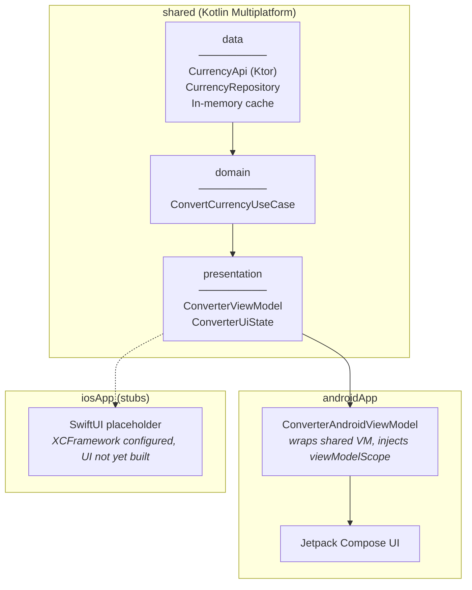

# KMP Currency Converter

[](https://github.com/hendra-marihot/kmp-currency-converter/actions/workflows/ci.yml)
[](LICENSE)

A currency converter built with Kotlin Multiplatform. The shared module owns data access, domain logic and presentation state. Android renders it with Jetpack Compose. The repo shows how I draw the line between shared and platform code.


## Why KMP

I have shipped cross-platform apps in Flutter. Flutter shares the UI too, which can hide whether an engineer knows where platform boundaries belong. KMP makes that choice explicit. The shared module compiles to a JVM library for Android and a native framework for iOS. Each platform writes its own UI and consumes the shared logic.

## Architecture

The shared module owns everything except the UI. Platform apps provide a UI and a lifecycle-aware coroutine scope.



Three decisions shape it:

**The shared ViewModel takes a `CoroutineScope`.** `ConverterViewModel` never references `viewModelScope` or any AndroidX class. Android passes `viewModelScope` from a thin wrapper. iOS would pass a scope tied to the SwiftUI lifecycle. Tests pass `CoroutineScope(StandardTestDispatcher())`. This keeps the shared module free of platform code with no extra library and no expect/actual boilerplate.

**A `Mutex` guards the cache.** If five conversions from USD start at once, only one HTTP request goes out. The rest wait on the lock and read from cache. A second check after taking the lock closes the race between the cache miss and the lock. A [concurrency test](shared/src/commonTest/kotlin/com/hendramarihot/currencyconverter/data/CurrencyRepositoryTest.kt) fires five requests and asserts one API call.

**State changes go through `MutableStateFlow.update {}`.** Direct `.value` writes are read-modify-write and race under concurrency. `update {}` is atomic.

## Library choices

| Choice | Instead of | Reason |
|---|---|---|
| Ktor | Retrofit + OkHttp | One API with an OkHttp engine on Android and a Darwin engine on iOS. Retrofit does not run on iOS |
| Koin | Hilt, Kodein, manual DI | First-class KMP support since 4.0 and lightweight. Hilt is Android only |
| Hand-written fakes | Mockito, MockK | `FakeCurrencyApi` implements the real `CurrencyApi` interface with configurable delay, errors and rates. It runs on every KMP target. Mock libraries are JVM only |
| kotlinx.serialization | Gson, Moshi | Kotlin-native and runs on every target |
| In-memory cache | Room, SQLDelight | Rates change often, so a session cache is enough. A database adds complexity without helping the user |

## Tests

28 tests in `shared/src/commonTest`. Run them with `./gradlew :shared:testAndroidHostTest`. They run as Android host tests through the AGP KMP library plugin, and `./gradlew :shared:allTests` adds the iOS simulator run on a Mac.

- **Repository (8):** cache hits and misses, error propagation, concurrent-fetch deduplication
- **Use case (7):** conversion math, zero amounts, unknown currencies, result shape
- **ViewModel (11):** initial state, loading transitions, success, errors, swapping, invalid input. Uses `StandardTestDispatcher` and `advanceUntilIdle()`
- **Response parsing (2):** `ExchangeRateResponse` deserialization

Not tested: the Compose UI and the Ktor client setup. The UI is thin, and testing the client would test Ktor.

## Out of scope

- **iOS UI.** The XCFramework builds and the consumption pattern is documented. The SwiftUI side is a stub. A full iOS UI is a separate project about SwiftUI and KMP interop.
- **Persistence.** Session caching is enough for exchange rates.
- **Staleness indicators.** The model has an epoch-millisecond timestamp from `kotlin.time.Clock` but the UI does not show it.
- **A full currency list.** 15 currencies are hardcoded. Production would fetch the list from the API.

## What I would improve

- **Error messages are raw exception strings.** They go straight to the Snackbar. Production needs a mapping layer with localizable messages.
- **No retry.** A failed call shows an error at once. Backoff and a retry button would help on flaky networks.
- **No Compose previews.** `AmountInput`, `CurrencySelector` and `ConversionResultCard` have no `@Preview` functions.
- **No coverage report.** Kover and a coverage gate would make the test discipline visible.

## Build and run

```bash
./gradlew :androidApp:installDebug        # Android app
./gradlew :shared:testAndroidHostTest     # shared tests
./gradlew :shared:assembleXCFramework     # iOS framework
# Output: shared/build/XCFrameworks/debug/shared.xcframework
```

Needs a JDK 17 or newer to run Gradle and the API 37 platform (`platforms;android-37.0`). If the local JDK is newer than 17, the toolchain resolver downloads JDK 17 for compilation. AGP installs the platform when the SDK licenses are accepted. Builds with Gradle 9.7, AGP 9.3 and Kotlin 2.4. Rates come from [open.er-api.com](https://www.exchangerate-api.com/docs/free), which needs no API key.

## Stack

| Technology | Version | Role |
|---|---|---|
| Kotlin Multiplatform | 2.4.21 | Shared logic for Android and iOS |
| Ktor | 3.6.0 | HTTP client with platform engines |
| kotlinx.serialization | 1.12.0 | JSON parsing |
| kotlinx.coroutines | 1.11.0 | Async work and Flow state |
| Koin | 4.2.2 | Dependency injection |
| Jetpack Compose BOM | 2026.09.00 | Android UI (Material 3) |

## Related repositories

Each repo in this set covers one area of mobile engineering.

| Repository | Focus |
|---|---|
| [compose-newsreader](https://github.com/hendra-marihot/compose-newsreader) | Multi-module Android, Hilt, Room, offline-first |
| [android-design-system](https://github.com/hendra-marihot/android-design-system) | Compose component library, design tokens |
| [compose-performance-lab](https://github.com/hendra-marihot/compose-performance-lab) | Compose performance anti-patterns and fixes |
| **kmp-currency-converter** (this repo) | Kotlin Multiplatform, shared business logic |
| [flutter-expense-tracker](https://github.com/hendra-marihot/flutter-expense-tracker) | Clean Architecture, Riverpod, Drift, Material 3 |
| [flutter-ui-toolkit](https://github.com/hendra-marihot/flutter-ui-toolkit) | Reusable widgets, shimmer, adaptive layouts |
| [flutter-platform-bridge](https://github.com/hendra-marihot/flutter-platform-bridge) | Platform channels, native interop |
| [mobile-ci-cd-templates](https://github.com/hendra-marihot/mobile-ci-cd-templates) | CI/CD, release automation |

## License

Copyright 2026 Hendra Marihot. Licensed under the [Apache License 2.0](LICENSE).
